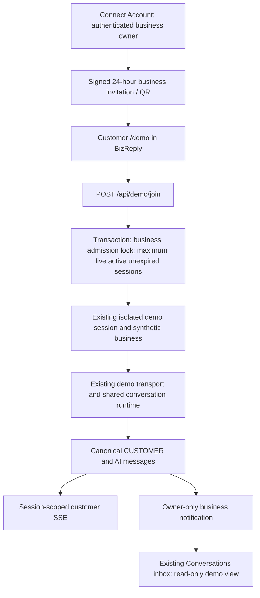

# In-app demo — Phase 1

## Changed files

Backend:
- `prisma/schema.prisma`
- `prisma/migrations/20261015120000_business_demo_sessions/migration.sql`
- `src/routes/demo.routes.ts`
- `src/services/business-demo.service.ts`
- `src/services/demo.service.ts`
- `src/services/demo-message.service.ts`
- `src/services/demo-realtime.service.ts`
- `src/services/demo-setup.service.ts`
- `src/services/conversation.service.ts`
- `tests/business-demo.test.ts`
- `docs/in-app-demo-phase-1.md`

Sibling frontend:
- `app/demo/page.tsx`
- `components/demo/business-demo-card.tsx`
- `components/demo/demo-customer-chat.tsx`
- `components/whatsapp/whatsapp-settings-page.tsx`
- `components/conversations/conversations-inbox.tsx`
- `components/conversations/conversation-workspace.tsx`
- `lib/conversations.ts`
- `types/conversation.ts`
- `package.json` and `pnpm-lock.yaml` (local QR renderer)
- `tests/demo.test.tsx` and `vitest.demo.config.mts`

## Audit and reuse

The frontend Connect Account screen is `components/whatsapp/whatsapp-settings-page.tsx`.
Its existing Conversations inbox loads `/conversations` and subscribes to authenticated
business SSE events; it also polls to recover missed events. Customer demo chat reuses
the existing `MessageBubble` and `ConversationComposer`, inside the same Next app at `/demo`.

The backend already has opaque demo credentials, one synthetic business/contact/conversation
per demo session, canonical message persistence, demo SSE, expiry cleanup and the shared
interpreter/state/planner/response runtime. Keeping these synthetic businesses preserves
the existing no-production-effects checks at workflow and provider boundaries.

## Flow

`DemoSession.hostBusinessId` links visibility to the real business without moving demo
messages into production tenants. Only BUSINESS_OWNER can create invitations or read this
bridge. Staff/manager scopes and all production mutation scopes remain unchanged. Owner
lists bypass shared manager caches; demo detail reads revalidate scope and expiry every time.
Demo records cannot be sent through production staff-message endpoints.

`POST /api/demo/business/invite` uses existing JWT/business membership authentication.
`POST /api/demo/join` accepts `{ invite }` plus optional `Idempotency-Key`; signed invitations
are not customer credentials and cannot read messages. Invitations are reusable for 24 hours.
The QR is rendered locally, never sent to a third-party QR service. Customer tokens are in
tab session storage, sent as Authorization headers, never URL query parameters. Refresh restores
the same session. Ending a session destroys only its synthetic records and releases capacity.

Admission uses a PostgreSQL transaction advisory lock keyed by host business, then counts
ACTIVE sessions with future expiry, then creates all isolated records atomically. Concurrent
customers on different IPs still share the five-session cap. Retry returns the existing
credential before checking capacity; expired retries create fresh records. Standalone legacy
demo sessions retain their IP cap and existing behavior.

New business sessions start READY using a bounded snapshot of the real business's profile,
active non-archived services, business hours and CUSTOMER_FACING policies. They use the
existing DemoContext adapter: catalog IDs remain synthetic, opening hours are not appointment
slots, no production Service/Appointment/CustomerMemory records are created. Customer setup
cannot overwrite this business-provided context. The snapshot intentionally excludes internal
policies, production customers, conversation history and Knowledge Hub documents.

## Operational requirements and limits

- Apply `20261015120000_business_demo_sessions` and regenerate Prisma before deployment.
  This implementation does not apply migrations to a live database automatically.
- Set `DEMO_ENABLED=true`; existing demo AI/provider configuration must be functional.
  Use a phone-reachable frontend origin and API URL (not localhost), with that origin allowed
  by backend CORS. The QR opens the frontend origin where it was generated.
- Sessions use `DEMO_SESSION_TTL_MINUTES` (default 60); existing cleanup sweeps erase synthetic
  records and retain credential tombstones briefly. Expired sessions stop counting immediately.
- Existing SSE is process-local. Live push is immediate on a single backend process; existing
  owner polling and customer five-second history polling recover missed/cross-process events.
  Distributed immediate push requires the existing transport's future shared pub/sub support.
- Owner view is observation-only in this phase. Demo rows appear in the existing inbox but
  are deliberately excluded from production quota/operational statistics.
- Public QR holders can consume the five slots; invitation expiry and existing IP rate limits
  bound access. Per-link revocation and owner kick controls are deferred.
- Business changes affect new sessions; running sessions retain their safe snapshot until expiry.
- Existing demo limits remain: one conversation per customer session and 50 customer/AI turns.

## Focused verification

Backend: `pnpm exec tsx --test tests/business-demo.test.ts tests/demo-session.test.ts
tests/demo-message.test.ts tests/demo-realtime.test.ts tests/demo-ai.test.ts tests/demo-setup.test.ts`.
Frontend: `pnpm exec vitest run --config vitest.demo.config.mts` and `pnpm exec tsc --noEmit`.
The admission test emulates transaction lock scheduling; it is not proof of live PostgreSQL
concurrency. A migrated test database and configured provider are required for the final
five-device QR-to-AI deployment smoke test. No live customer data was changed for this work.

Verified locally: 66 focused backend tests and 4 frontend tests passed. Backend typecheck
and test typecheck passed; frontend typecheck and focused lint were also run.
